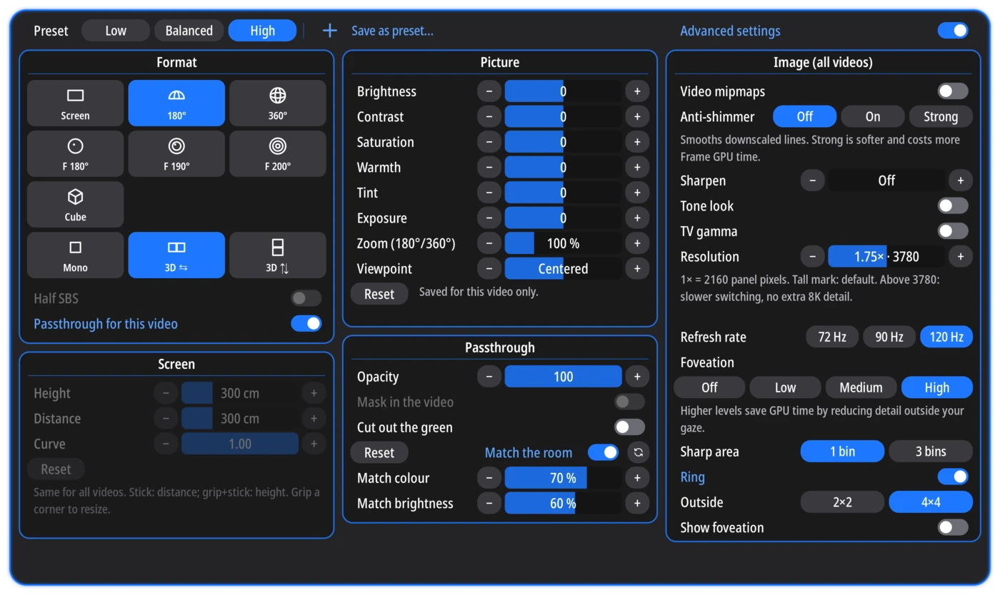

<h1 align="center">
  
  
</h1>

<p align="center">
  <b>A native VR video player for the Steam Frame: 8K 180° and 360° video at 120 Hz.</b>
</p>

<p align="center">
  <a href="https://github.com/seaweeduk/VideoFrameVR/releases/latest"><b>Download</b></a> ·
  <a href="#install">Install</a> ·
  <a href="#report-a-problem">Report a problem</a> ·
  <a href="#request-a-feature">Request a feature</a>
</p>

<p align="center">
  <a href="https://seaweeduk.github.io/VideoFrameVR/discord/">
    
  </a>
</p>

<p align="center">
  
</p>

**Runs natively on the Steam Frame and on Linux PCs** with SteamVR and any headset.
Hardware decoding on a PC needs an NVIDIA GPU.

- **Hardware decoding** on the Steam Frame: 8K 60 fps HEVC (8-bit and 10-bit)
  and H.264 without dropped frames, tested up to 150 Mbit/s over SMB.
- **Tuned for the Steam Frame**: video goes straight from the hardware decoder
  to the GPU without being copied through the CPU, leaving the GPU headroom to
  spare and keeping power, heat and fan noise down.
- **Eye-tracked foveated rendering**: 3780 × 3780 pixels per eye at 120 Hz out
  of the box, and you can push it up to 4608 if you want more.
- **Presets and per-video settings**: Low, Balanced and High, or save your own.
  Advanced settings open up every rendering option, and each video remembers
  its own format, picture, stereo focus and passthrough.
- **Stereo focus** lines up the two eyes' images at the distance you're looking
  at, so close-ups in 3D 180° and fisheye video don't strain your eyes. On the
  Steam Frame it follows your gaze.
- **Passthrough**: videos with their own alpha mask (DeoVR) or a green screen
  put the people in them into your room.
- **180°, 360°, fisheye and flat video**, 2D or 3D, from the headset, microSD,
  USB or SMB shares (built-in client, no mounting).
- **Offline downloads** copy videos from SMB or Stash to the headset, a microSD
  card or a USB drive, to watch without a network.
- **[Stash](https://stashapp.cc) integration** (optional): browse and filter
  your scenes by performer, studio and tag, with covers and moving previews.
  Your library syncs to the app, so it works even while the server is off.
  Scenes stream straight from Stash, and ratings and play counts sync back.

Native C++ with Vulkan rendering straight into OpenXR, mpv and FFmpeg for
decoding (the Steam Frame's hardware decoder, or NVDEC on NVIDIA), and Cairo
and Pango for the menus.

<table>
  <tr>
    <td width="50%"></td>
    <td width="50%"></td>
  </tr>
  <tr>
    <td align="center">Stash, filtered by tag, performer or cast</td>
    <td align="center">Steam Frame video settings</td>
  </tr>
</table>

## Install

Get the installer from [Releases](https://github.com/seaweeduk/VideoFrameVR/releases).
There's one file for each device:

| Device      | File                                             |
| ----------- | ------------------------------------------------ |
| Steam Frame | `Install-VideoFrameVR-<version>-aarch64.desktop` |
| Desktop PC  | `Install-VideoFrameVR-<version>-x86_64.desktop`  |

### Steam Frame

1. Switch to Desktop Mode and download the installer.
2. Open it from your Downloads folder. If asked, choose **Launch**, then **Continue**.
3. Choose **Install**. VideoFrameVR is added to your Steam library.

### Desktop PC

You need Steam (not the Flatpak version), SteamVR and zenity. Video decoding uses
the GPU on NVIDIA cards; other cards decode on the CPU.

1. Download the installer and open it.
2. Choose **Install**.
3. Choose **Add to Steam**, or **Restart Steam** if Steam is open.

If Steam asks to download Steam Linux Runtime 4.0, let it finish, then open the
installer again.

### Updating and uninstalling

When a new version is out, the app tells you. Choose **Update now**.

To uninstall, right-click VideoFrameVR in the application menu, or open the
installer again, and choose **Uninstall**. Your settings and history are kept.

## Report a problem

1. In the app, open **Settings → Help → Save diagnostics**. It saves a zip of the
   app's logs and settings to your Downloads folder, with file names, folders and
   server addresses removed.
2. [Open an issue](https://github.com/seaweeduk/VideoFrameVR/issues/new/choose)
   and attach the zip.

If the app won't start, run this in a terminal to save the zip instead:

```sh
~/Applications/VideoFrameVR/videoframevr.sh --save-diagnostics
```

## Request a feature

[Open a feature request](https://github.com/seaweeduk/VideoFrameVR/issues/new?template=feature_request.yml)
and say what you'd like to do and why the app doesn't let you today.

## Discord

[Join the Discord](https://seaweeduk.github.io/VideoFrameVR/discord/) to get
help, share ideas or chat about the app.

## Contributing

See [CONTRIBUTING.md](CONTRIBUTING.md). To build the app yourself, see
[BUILDING.md](BUILDING.md).

## AI disclosure

This app was written with the help of the latest frontier AI models from
Anthropic and OpenAI, using [OpenCode](https://github.com/anomalyco/opencode).

## License

VideoFrameVR is free software under the GNU General Public License, version 3.
See [LICENSE](LICENSE). Each release has source archives with the exact source
used to build it.

It is a modified version of [tuxVRdome](https://github.com/tzyvkq9eoyrg/tuxVRdome)
by PandaSoda45, forked at commit `4c14ef8` (12 October 2026) and modified by
seaweeduk since then.

Third-party components bundled with a release, and their licences, are listed in
the `THIRD-PARTY-NOTICES` file inside it and under `share/licenses/`.

[Screenshot credits](.github/readme/CREDITS.md).
